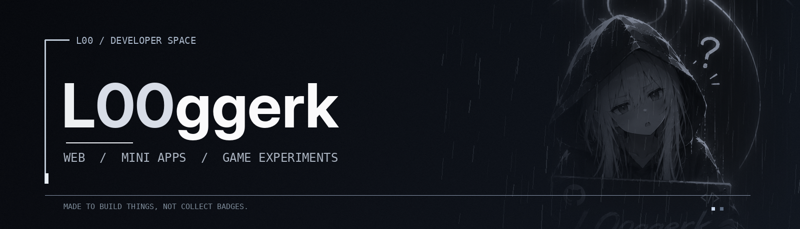

  

 

  <strong>Small projects. Sharp ideas. Less noise.</strong>
  
I like taking odd ideas and turning them into things you can actually try.

---

### What I'm into

| 01 — Web | 02 — Telegram | 03 — Games |
|:---|:---|:---|
| Interfaces, interactive pages and tiny tools. | Mini apps, bots and experiments. | Browser games and unusual mechanics. |

### Currently

Exploring ideas, building prototypes, learning by doing. Not everything has to be a giant project to be worth making.

### Take a look around

[**Explore my repositories →**](https://github.com/L00ggerk?tab=repositories)

No fake counters, no endless badges — just code and projects as they come.
